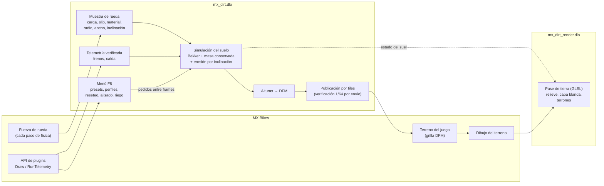
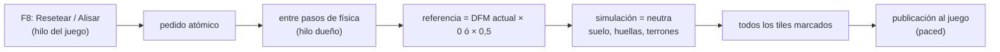
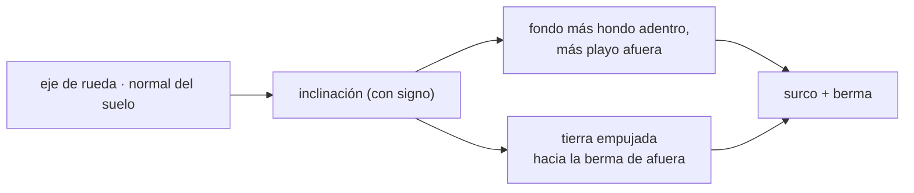
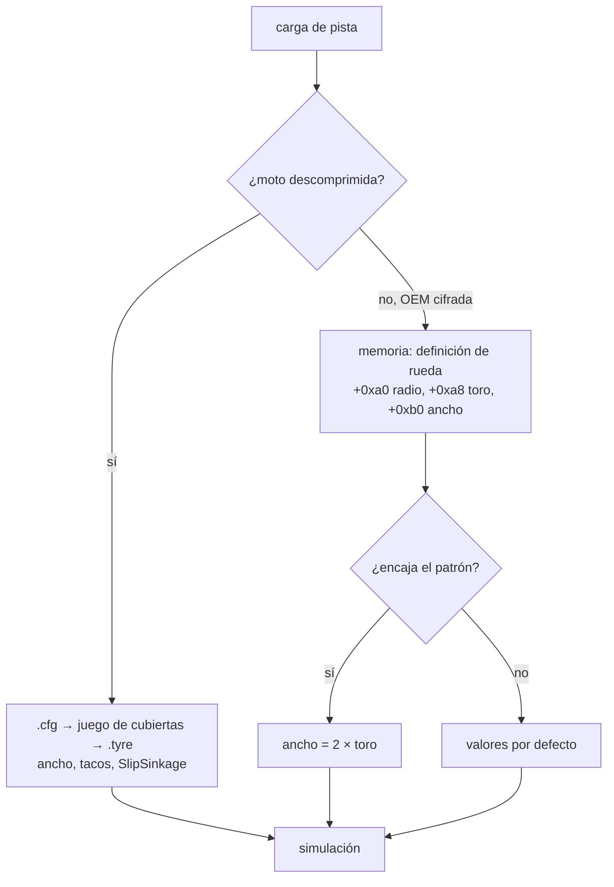
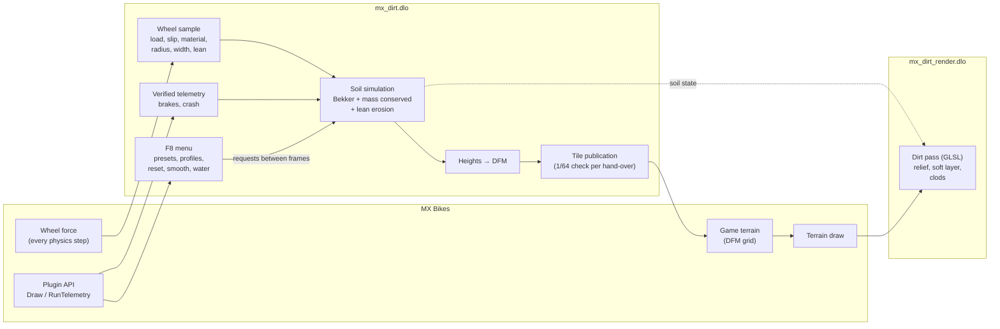
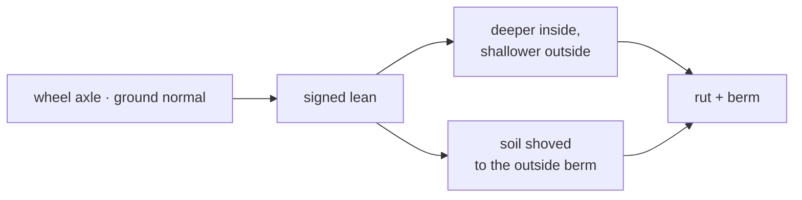
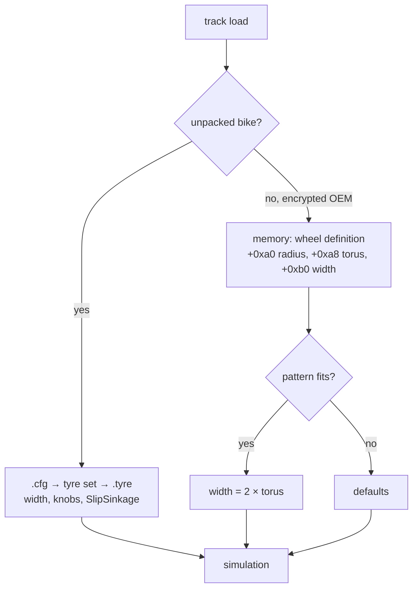

# MX Dirt Mod Alt

**[Español](#español) · [English](#english)**

> Versión alternativa de **[MX Dirt Mod](https://github.com/kadenball/mx-dirt-mod)** de **kadenball** para MX Bikes.
> An alternative version of **[MX Dirt Mod](https://github.com/kadenball/mx-dirt-mod)** by **kadenball** for MX Bikes.

   

---

## Español

### Qué es

**MX Dirt Mod Alt** es una versión alternativa del **MX Dirt Mod** de **kadenball**. No es el mod oficial ni lo reemplaza: parte de su versión 1.7.1 y agrega un menú dentro del juego, herramientas de pista, erosión según la inclinación de la moto, cubiertas reales por moto, presets y varias correcciones que salieron de usarlo de verdad y de leer sus logs.

Todo el mérito del sistema de tierra (simulación del suelo, publicación en el terreno del juego, pre-wear, capa blanda, render) es de **kadenball**. Esta versión se construyó encima de ese trabajo.

> **¿Sos kadenball?** Me encantaría colaborar y llevar lo que sirva de acá al mod original. Escribime por Discord: **`fran8035`**.

### Créditos

- **MX Dirt Mod** — [kadenball](https://github.com/kadenball/mx-dirt-mod), GPL-3.0. Autor del mod original y de todo lo que este fork no toca.
- **MX Dirt Mod Alt** — Fran Milesi ([FMilesi-Cloud](https://github.com/FMilesi-Cloud)), con ayuda de Claude (Anthropic) para el análisis, el código y la documentación.
- **MX Bikes** — © PiBoSo. Este proyecto no está afiliado ni avalado por PiBoSo.

### Qué cambia respecto del original

| Área | Qué hace esta versión | Por qué |
|---|---|---|
| **Menú en el juego (F8)** | Reemplaza al launcher de PowerShell. 5 pestañas (Física, Visual, Pista, Presets, Overhaul), teclado **y mouse**, cambios en vivo, **español e inglés**. | Ajustar sin salir del juego. |
| **Reseteo y alisado en vivo** | "Resetear todo ahora" (pista a cero) y "Alisar" (surcos a la mitad), sin salir de la pista. | Practicar una zona siempre con tierra fresca. |
| **Regar la pista** | Vuelve la humedad al valor de riego; después se seca sola. | Como el camión de riego entre mangas. |
| **Presets** | 6 de base (Realista, Pro después de manga, Arcade, Barro, Arena, Rendimiento) + **guardar como… escribiendo el nombre**. Física y visual juntos. | Cambiar todo el carácter de la tierra de un toque. |
| **Perfil por pista** | Cada pista puede recordar su propia configuración. | Una pista de arena no se ajusta igual que una de SX. |
| **Ancho de surco en metros** | `rut_width_cm`: el mismo ancho en todas las pistas (antes dependía de la malla). | Pistas con mallas distintas daban surcos de 30 a 55 cm. |
| **Tope de ángulo de pared** | `wall_angle_deg` (40° por defecto). | Las paredes llegaban a ~59°: la rueda delantera "pegaba como contra un tronco". |
| **Erosión por inclinación** | Una rueda inclinada corta más hondo del lado de adentro de la curva y empuja la tierra a la berma de afuera. | Antes una rueda a 40° cortaba igual que una vertical. |
| **Cubiertas reales por moto** | Ancho de cada cubierta leído de la **memoria del juego** (motos OEM cifradas) o de sus `.tyre` (motos descomprimidas); radio real de cada rueda. | Antes todo era 11/15 cm y 0,33/0,35 m fijos. |
| **Telemetría oficial** | Frenos del piloto ensanchan las filas de baches; una moto caída no cava. Se verifica sola antes de usarse. | Datos oficiales de la API, sin ingeniería inversa. |
| **Humedad del juego / Overhaul** | Sigue la "pista mojada" del juego y, opcional, la de Graphics Overhaul (`OverhaulTrackWetness`). Se ve en el menú. Nunca depende de Overhaul. | Lluvia coherente con el suelo. |
| **Compatibilidad con Graphics Overhaul** | El render se encadena sobre los hooks de OpenGL de Overhaul en vez de apagarse, y se vuelve a enganchar en la carga siguiente. | Con Overhaul instalado el render no dibujaba nada. |
| **Capa blanda más larga** | Ventana de 102 m (antes 51 m) centrada 25 m adelante. | El detalle aparecía de golpe a ~35 m. |
| **Logs que sobreviven a un crash** | Se guardan cada 10 s; estado del mod y ms de CPU/GPU en el menú. | Antes un crash borraba todo lo que había pasado. |

### Novedades (alt.2)

| Área | Qué hace |
|---|---|
| Huella según la tracción | Empujada o remando a paso de hombre la rueda apenas aplasta; acelerando corta y tira tierra atrás. |
| Marcas de botas | Remando sentado, el pie deja la suela marcada al costado (más honda en barro). |
| Pre-wear por cilindrada | El desgaste inicial mezcla 125 / 250 / 450 según la categoría (MX1, MX2, MX3, MXE). |
| Marcas de caída | La moto que se desliza caída cava un surco que se angosta al frenar. |
| Bermas que revientan | La tierra suelta de una berma cede si la fuerza lateral (velocidad × giro) le gana. |
| Base dura que aflora | Donde los surcos llegan a la base, queda pelada: más dura, más oscura, con más vibración. |
| Costra seca | La tierra compactada y seca que nadie pisa forma costra con grietas; la rueda la rompe en terrones. |
| Charcos y erosión | La lluvia (Overhaul o el clima del juego) se junta en los surcos (barro) y baja por las pendientes llevándose tierra. |
| Whoops de arena | En rectas de arena crecen whoops regulares vuelta a vuelta. |
| Labios realistas (opcional) | Los labios se gastan y forman kicker; los aterrizajes cortos cavan pozos. Apagado por defecto. |
| Cuadrilla de pista | Niveladora y camión regador en 3D que recorren tu línea grabada y alisan o riegan detrás. Ruedas que giran, sombra y rocío. |
| Animaciones | Resetear y alisar avanzan como una ola desde la moto; el riego moja de a poco; una línea en pantalla muestra el avance. Se pueden saltar ("Saltar animaciones"). |

**Máquinas 3D.** El mod trae sus propios modelos low-poly (niveladora y camión regador, hechos para este proyecto, GPL-3.0). Si querés usar modelos de la comunidad, convertilos con `tools/crew_export.py` (Blender) y ponelos en `plugins\mx_dirt_data\crew\community\dozer` y `...\truck`; el F8 deja elegir. Probado con el **J9 Bull Dozer** de [Jason9](https://mxb-mods.com/j9-bull-dozer/) y el **Water/Dump Truck v1** de [RedRider197](https://mxb-mods.com/water-dump-truck-v1/). Esos modelos **no se incluyen** en este repo: son de sus autores, bajalos de sus páginas.

### Rendimiento comparado con el original

Mismo recorrido sintético para las dos versiones (`tests/bench_sim.c`): grilla de 2048 sobre 600 m, una moto girando un óvalo de 520 m durante 60 s a 50 Hz, frenando en las curvas y patinando a la salida; después, un pre-wear de 50 pilotos. Medido en una notebook con RTX 3050, compilado con `zig cc -O2`, promedio de 3 corridas.

| Por paso (50 por segundo) | Original 1.7.1 | Alt.2 |
|---|---|---|
| Simulación del suelo (2 ruedas + avalanchas) | 0,036 ms | 0,039 ms |
| Capa blanda (huella visible) | 0,054 ms | 0,054 ms |
| Clima: costra, charcos, erosión (lluvia la mitad del tiempo) | — | 0,036 ms |
| Marcas de caída y bermas | — | 0,0002 ms |
| **Total** | **0,090 ms** | **0,129 ms** |
| Pre-wear de 50 pilotos (una vez al cargar) | 1,54 s | 1,63 s |

En el juego (log de esta versión, 2560×1440): simulación 0,075 ms por paso, conversión de alturas 0,044 ms, pase de render en GPU 2,5 ms de mediana (p90 3,5 ms). Las máquinas 3D suman entre 900 y 6800 triángulos solo mientras están en pista.

### Correcciones

- **Crash del menú F8** (desarrollo de este fork): el arreglo de textos era más chico que los textos dibujados y pisaba memoria del núcleo. Corregido y con tope.
- **Tirones al mandar terreno al juego**: el código original verificaba la grilla entera (16 MB) varias veces por envío; después de un reseteo eso congelaba el juego segundos. Primero lo limitamos acá; luego kadenball publicó en la 1.7.1 un arreglo mejor (verificar 1/64 de la grilla por envío, rotando), que es el que usa esta versión.
- **Los surcos ya hechos no se resetean a la pista guardada**: el reseteo cambia la superficie de referencia, no solo la simulación (tiene test).
- **Inicialización de parámetros**: los parámetros de la simulación ahora arrancan en cero antes de configurarse.

### Cómo funciona (pipeline)



Más diagramas (cómo funciona cada cosa nueva): [`docs/diagrams/`](docs/diagrams/) y la sección [Lo nuevo, por dentro](#lo-nuevo-por-dentro).

### Instalación

**Requisitos:** Windows 10/11 64 bits, **MX Bikes de Steam, build 23566986** (el hash exacto está en `SUPPORTED_EXE.txt`; con otra versión el mod se apaga solo y el juego anda normal), OpenGL 4.

1. Cerrá MX Bikes.
2. Bajá `MX-Dirt-Mod-Alt-<versión>.zip` de **Releases** y descomprimilo.
3. Doble clic en **`Install.cmd`**. Hace backup de todo lo que reemplaza en `Documents\PiBoSo\MX Bikes\mx_dirt_mod_backups`.
   - A mano: copiá `plugins\mx_dirt.dlo`, `plugins\mx_dirt_render.dlo`, los dos `.ini` y la carpeta `plugins\mx_dirt_data` a `MX Bikes\plugins`.
4. Si tenés el MX Dirt Mod original, este lo reemplaza (usan los mismos archivos). Tus ajustes `.ini` se conservan.
5. En el juego, **F8** abre el menú.

#### Fuente del menú

Las fuentes de MX Bikes (`.fnt`) son conversiones de tipografías y esta versión **no incluye ninguna** para no redistribuir trabajo ajeno. El menú usa la primera que encuentra:

1. `plugins\mx_dirt_data\menu.fnt` (poné ahí cualquier `.fnt` de MX Bikes que tengas permiso de usar),
2. la fuente Inter del plugin HUD **MXB-MRP3** (`plugins\mxbmrp3_data\fonts\Inter-Regular.fnt`) si lo tenés instalado,
3. cualquier `.fnt` dentro de `plugins\mx_dirt_data\`.

Sin fuente, el mod funciona igual; solo no se dibuja el menú.

### Menú F8

| Tecla / mouse | Acción |
|---|---|
| **F8** | abrir / cerrar |
| **Tab** / Shift+Tab, clic en la pestaña | cambiar de pestaña |
| ↑ ↓, clic en la fila | elegir |
| ← →, clic en `<` `>` (mantener = repetir) | cambiar el valor |
| **Enter**, clic | ejecutar una acción / aplicar un preset |
| **Supr** | valor por defecto |

- Las filas con `*` se aplican en la próxima carga de pista.
- Resetear, Alisar y Borrar perfil piden confirmación (dos veces en 3 s).
- Arriba se ve: si la simulación corre, si el render dibuja o algún plugin lo bloqueó, **ms de GPU y CPU**, humedad del suelo y de dónde viene la lluvia.
- **Idioma / Language**: pestaña Pista, primera fila.

### Ajustes nuevos (`mx_dirt.ini`)

| Clave | Defecto | Qué hace |
|---|---|---|
| `rut_width_cm` | 36 | Ancho del surco en cm, igual en todas las pistas (0 = como el original). |
| `wall_angle_deg` | 40 | Pared de surco más empinada permitida (0 = sin tope). |
| `lean_erosion_percent` | 100 | Cuánto corta adentro y empuja afuera una rueda inclinada (0..200). |
| `use_telemetry` | 1 | Usar frenos y caídas de la telemetría oficial. |
| `use_bike_tyres` | 1 | Usar el ancho real de las cubiertas de la moto. |
| `follow_game_weather` | 1 | La humedad sigue la "pista mojada" del juego. |
| `[overhaul] sync_rain` | 1 | La humedad sigue la pista mojada de Graphics Overhaul (si está). |
| `[menu] language` | 0 | Idioma del menú: 0 español, 1 inglés. |

Los presets están en `plugins\mx_dirt_presets\*.ini` y los perfiles por pista en `plugins\mx_dirt_tracks\`. Son texto: se editan con el Bloc de notas.

### Lo nuevo, por dentro

**Reseteo y alisado.** La simulación guarda alturas *relativas a la pista tal como se cargó*. Por eso no alcanza con poner la simulación en cero: se reemplaza la superficie de referencia (`0` = pista limpia, `×0,5` = surcos a la mitad) y se reenvía la pista entera por el mismo camino que usa el pre-wear.



**Erosión por inclinación.** La inclinación es el seno entre el eje de la rueda y la normal del suelo (no depende de hacia dónde apunte el eje). El fondo del surco se inclina y la tierra cortada va a la berma exterior.



Medido con el test `tests/test_lean.c` (rueda a 0,6 de inclinación, 3 s en tierra virgen): fondo interior −6,1 cm vs exterior −4,4 cm; berma exterior 9,5 mm vs interior 5,9 mm (derecha: −5,4/−5,4 cm y 7,6/8,2 mm).

**Ancho de cubierta.** Las motos OEM y sus cubiertas están cifradas. El juego ya cargó la cubierta en memoria; en la definición de la rueda, después del radio, vienen `TorusRadius` y `Width` en el mismo orden que en un `.tyre`. Solo se usan si encajan con ese patrón; si no, quedan los valores por defecto. Confirmado en el juego con una Honda CRF250R OEM: radio 0,3415/0,3232 m, toro 0,0481/0,0725 m, `radiusRPS` 0,0001 → **9,6 cm adelante, 14,5 cm atrás**.



**Telemetría.** Antes de usarla se comprueban el tamaño que manda el juego y que el material bajo cada rueda coincida con el que lee el mod (90 % de 400 muestras). Si no, queda apagada y el log dice por qué.

### Estado y limitaciones

- La lectura de **telemetría** todavía no se verificó en el juego (el diagnóstico está en el log, línea `telemetry`).
- Lo de **agarre según el suelo** (modificar las fuerzas del neumático) quedó fuera a propósito.
- Las pistas siguen cifradas: no se pueden leer sus materiales por adelantado.
- **Online** sigue siendo experimental, como en el original.

### Compilar

Necesitás [Zig](https://ziglang.org/) 0.13 o más nuevo.

```
.\build.ps1                         # build\mx_dirt.dll        -> plugins\mx_dirt.dlo
.\build_render.ps1                  # build\mx_dirt_render.dll -> plugins\mx_dirt_render.dlo
.\package.ps1 -Version 1.7.1-alt.1  # zip de release en build\
```

Tests (sin el juego): `tests/test_rebase.c`, `tests/test_lean.c`, `tests/test_bike_tyres.c` (instrucciones en cada archivo).

Historia completa del desarrollo: **[docs/DESARROLLO.md](docs/DESARROLLO.md)**. README original: [docs/UPSTREAM_README.md](docs/UPSTREAM_README.md).

### Licencia

GPL-3.0, igual que el original (ver `LICENSE` y `NOTICE.md`). El código original es © kadenball; las modificaciones están marcadas con `fork:` en el código.

---

## English

### What it is

**MX Dirt Mod Alt** is an alternative version of **kadenball's MX Dirt Mod**. It is not the official mod and does not replace it: it starts from its 1.7.1 release and adds an in-game menu, track tools, lean-angle erosion, each bike's real tyres, presets, and several fixes that came out of actually riding with it and reading its logs.

All the credit for the dirt system (soil simulation, publishing into the game's terrain, pre-wear, soft layer, rendering) goes to **kadenball**. This version is built on top of that work.

> **Are you kadenball?** I'd love to collaborate and bring whatever is useful here into the original mod. Reach me on Discord: **`fran8035`**.

### Credits

- **MX Dirt Mod** — [kadenball](https://github.com/kadenball/mx-dirt-mod), GPL-3.0. Author of the original mod and of everything this fork does not touch.
- **MX Dirt Mod Alt** — Fran Milesi ([FMilesi-Cloud](https://github.com/FMilesi-Cloud)), with help from Claude (Anthropic) for the analysis, code and documentation.
- **MX Bikes** — © PiBoSo. This project is not affiliated with or endorsed by PiBoSo.

### What changes from the original

| Area | What this version does | Why |
|---|---|---|
| **In-game menu (F8)** | Replaces the PowerShell launcher. 5 tabs (Physics, Look, Track, Presets, Overhaul), keyboard **and mouse**, live changes, **Spanish and English**. | Tune without leaving the game. |
| **Live reset and smooth** | "Reset everything now" (track back to zero) and "Smooth" (ruts halved), without leaving the track. | Practise a section on fresh dirt every time. |
| **Water the track** | Moisture back to the watering value; then it dries by itself. | Like the water truck between motos. |
| **Presets** | 6 built in (files named in Spanish: Realista = realistic, Pro despues de manga = pro after moto, Arcade, Barro = mud, Arena = sand, Rendimiento = performance) + **save as… with a typed name**. Physics and look together. | Change the whole character of the dirt in one go. |
| **Per-track profile** | Each track can remember its own settings. | A sand track is not tuned like an SX one. |
| **Rut width in metres** | `rut_width_cm`: the same width on every track (it used to follow the mesh). | Tracks with different meshes gave 30 to 55 cm ruts. |
| **Wall angle cap** | `wall_angle_deg` (40° default). | Walls reached ~59°: the front wheel "hit them like a log". |
| **Lean erosion** | A leaned wheel cuts deeper on the inside of the turn and shoves soil into the outside berm. | A wheel at 40° used to cut exactly like an upright one. |
| **Each bike's real tyres** | Each tyre's width read from the **game's memory** (encrypted OEM bikes) or from its `.tyre` (unpacked bikes); each wheel's real radius. | It was a fixed 11/15 cm and 0.33/0.35 m. |
| **Official telemetry** | The rider's brakes widen the braking-bump rows; a crashed bike digs nothing. Self-verified before use. | Official API data, no reverse engineering. |
| **Game / Overhaul wetness** | Follows the game's "wet track" and, optionally, Graphics Overhaul's (`OverhaulTrackWetness`). Shown in the menu. Never depends on Overhaul. | Rain consistent with the soil. |
| **Graphics Overhaul compatibility** | The renderer chains onto Overhaul's OpenGL hooks instead of switching off, and re-hooks on the next load. | With Overhaul installed the renderer drew nothing. |
| **Longer soft layer** | 102 m window (was 51 m) centred 25 m ahead. | Detail popped in ~35 m ahead. |
| **Logs that survive a crash** | Saved every 10 s; mod state and CPU/GPU ms in the menu. | A crash used to lose everything. |

### What's new (alt.2)

| Area | What it does |
|---|---|
| Print by traction | Pushed or paddled at walking pace the tyre only presses; on the gas it cuts and throws soil back. |
| Boot prints | Paddling while seated, the boot leaves its sole beside the bike (deeper in mud). |
| Pre-wear by engine size | The starting wear mixes 125 / 250 / 450 riders by category (MX1, MX2, MX3, MXE). |
| Crash marks | A bike sliding on its side ploughs a groove that narrows as it stops. |
| Berm blowouts | Loose soil on a berm gives way when the lateral force (speed × turn rate) beats it. |
| Bare hard base | Where ruts reach the base it is left bare: harder, darker, more chatter. |
| Dry crust | Packed dry soil nobody rides grows a cracked crust; tyres break it into clods. |
| Puddles and erosion | Rain (Overhaul or the game's weather) pools in ruts (mud) and runs downhill carrying soil. |
| Sand whoops | Regular whoops grow lap after lap on sand straights. |
| Realistic lips (optional) | Lips wear into kickers, short landings dig holes. Off by default. |
| Track crew | A 3D grader and water truck drive your recorded line, smoothing or watering behind them. Turning wheels, shadow and spray. |
| Animations | Reset and smooth spread as a wave from the bike; watering soaks in gradually; an on-screen line shows progress. Can be skipped ("Skip animations"). |

**3D machines.** The mod ships its own low-poly models (grader and water truck, made for this project, GPL-3.0). To use community models, convert them with `tools/crew_export.py` (Blender) into `plugins\mx_dirt_data\crew\community\dozer` and `...\truck`; the F8 menu picks them. Tested with **J9 Bull Dozer** by [Jason9](https://mxb-mods.com/j9-bull-dozer/) and **Water/Dump Truck v1** by [RedRider197](https://mxb-mods.com/water-dump-truck-v1/). Those models are **not included** here: they belong to their authors, get them from their pages.

### Performance against the original

The same synthetic ride for both versions (`tests/bench_sim.c`): a 2048 grid over 600 m, a bike lapping a 520 m oval for 60 s at 50 Hz, braking into turns and spinning out; then a 50-rider pre-wear. Measured on an RTX 3050 laptop, `zig cc -O2`, mean of 3 runs.

| Per step (50 a second) | Original 1.7.1 | Alt.2 |
|---|---|---|
| Soil simulation (2 wheels + slumping) | 0.036 ms | 0.039 ms |
| Soft layer (visible print) | 0.054 ms | 0.054 ms |
| Weather: crust, puddles, erosion (raining half the time) | — | 0.036 ms |
| Crash marks and berms | — | 0.0002 ms |
| **Total** | **0.090 ms** | **0.129 ms** |
| 50-rider pre-wear (once, on load) | 1.54 s | 1.63 s |

In game (this version's log, 2560×1440): simulation 0.075 ms a step, height conversion 0.044 ms, GPU render pass 2.5 ms median (p90 3.5 ms). The 3D machines add 900 to 6800 triangles only while they are out.

### Fixes

- **F8 menu crash** (during this fork's development): its text array was smaller than what it drew and overwrote core memory. Fixed and bounded.
- **Stutter when terrain is handed to the game**: the original code checked the whole grid (16 MB) several times per hand-over; after a reset that froze the game for seconds. We first limited it here; then kadenball released a better fix in 1.7.1 (check 1/64 of the grid per hand-over, rotating), which is what this version uses.
- **Existing ruts don't reset to the saved track**: the reset replaces the reference surface, not only the simulation (tested).
- **Parameter initialisation**: the simulation's parameters now start at zero before they are set.

### How it works (pipeline)



More diagrams (how each new part works): [`docs/diagrams/`](docs/diagrams/) and the section [What's new, inside](#whats-new-inside).

### Install

**Requirements:** Windows 10/11 64-bit, **MX Bikes from Steam, build 23566986** (exact hash in `SUPPORTED_EXE.txt`; with any other version the mod switches itself off and the game runs normally), OpenGL 4.

1. Close MX Bikes.
2. Download `MX-Dirt-Mod-Alt-<version>.zip` from **Releases** and extract it.
3. Double-click **`Install.cmd`**. Everything it replaces is backed up to `Documents\PiBoSo\MX Bikes\mx_dirt_mod_backups`.
   - By hand: copy `plugins\mx_dirt.dlo`, `plugins\mx_dirt_render.dlo`, both `.ini` files and the `plugins\mx_dirt_data` folder into `MX Bikes\plugins`.
4. If you have the original MX Dirt Mod, this one replaces it (same files). Your `.ini` settings are kept.
5. In game, **F8** opens the menu.

#### Menu font

MX Bikes fonts (`.fnt`) are conversions of typefaces, so this version **ships none**, to avoid redistributing someone else's work. The menu uses the first one it finds:

1. `plugins\mx_dirt_data\menu.fnt` (put there any MX Bikes `.fnt` you are allowed to use),
2. the Inter font of the **MXB-MRP3** HUD plugin (`plugins\mxbmrp3_data\fonts\Inter-Regular.fnt`) if installed,
3. any `.fnt` inside `plugins\mx_dirt_data\`.

Without a font the mod works the same; only the menu is not drawn.

### F8 menu

| Key / mouse | Action |
|---|---|
| **F8** | open / close |
| **Tab** / Shift+Tab, click a tab | switch tab |
| ↑ ↓, click a row | select |
| ← →, click `<` `>` (hold = repeat) | change the value |
| **Enter**, click | run an action / apply a preset |
| **Delete** | default value |

- Rows marked `*` apply on the next track load.
- Reset, Smooth and Delete profile ask twice (within 3 s).
- The top shows whether the simulation runs, whether the renderer draws or another plugin blocked it, **GPU and CPU ms**, soil moisture and where the rain comes from.
- **Idioma / Language**: Track tab, first row.

### New settings (`mx_dirt.ini`)

| Key | Default | What it does |
|---|---|---|
| `rut_width_cm` | 36 | Rut width in cm, the same on every track (0 = as the original). |
| `wall_angle_deg` | 40 | Steepest rut wall allowed (0 = no cap). |
| `lean_erosion_percent` | 100 | How much a leaned wheel cuts inside and shoves outside (0..200). |
| `use_telemetry` | 1 | Use brakes and crashes from the official telemetry. |
| `use_bike_tyres` | 1 | Use the bike's real tyre widths. |
| `follow_game_weather` | 1 | Moisture follows the game's "wet track". |
| `[overhaul] sync_rain` | 1 | Moisture follows Graphics Overhaul's wet track (if installed). |
| `[menu] language` | 0 | Menu language: 0 Spanish, 1 English. |

Presets live in `plugins\mx_dirt_presets\*.ini` and per-track profiles in `plugins\mx_dirt_tracks\`. They are plain text: edit them with Notepad.

### What's new, inside

**Reset and smooth.** The simulation stores heights *relative to the track as it was loaded*. So zeroing the simulation is not enough: the reference surface is replaced (`0` = clean track, `×0.5` = ruts halved) and the whole track is resent through the same path pre-wear uses.


**Lean erosion.** Lean is the sine between the wheel's axle and the ground normal (independent of which way the axle points). The rut floor tilts and the cut soil goes to the outside berm.



Measured by `tests/test_lean.c` (wheel at 0.6 lean, 3 s on fresh dirt): inside floor −6.1 cm vs outside −4.4 cm; outside berm 9.5 mm vs inside 5.9 mm (upright: −5.4/−5.4 cm and 7.6/8.2 mm).

**Tyre width.** OEM bikes and their tyres are encrypted. The game has already loaded the tyre into memory; in the wheel definition, right after the radius, come `TorusRadius` and `Width` in the same order as in a `.tyre`. They are used only when they fit that pattern; otherwise the defaults stay. Confirmed in game with an OEM Honda CRF250R: radius 0.3415/0.3232 m, torus 0.0481/0.0725 m, `radiusRPS` 0.0001 → **9.6 cm front, 14.5 cm rear**.



**Telemetry.** Before use, the size the game sends is checked, and the material under each wheel must match the one the mod reads itself (90 % of 400 samples). Otherwise it stays off and the log says why.

### Status and limits

- **Telemetry** reading is not verified in game yet (the diagnosis is in the log, `telemetry` line).
- **Grip from the soil state** (changing the tyre forces) was left out on purpose.
- Tracks are still encrypted: their materials can't be read in advance.
- **Online** is still experimental, as in the original.

### Build

You need [Zig](https://ziglang.org/) 0.13 or newer.

```
.\build.ps1                         # build\mx_dirt.dll        -> plugins\mx_dirt.dlo
.\build_render.ps1                  # build\mx_dirt_render.dll -> plugins\mx_dirt_render.dlo
.\package.ps1 -Version 1.7.1-alt.1  # release zip in build\
```

Tests (no game needed): `tests/test_rebase.c`, `tests/test_lean.c`, `tests/test_bike_tyres.c` (instructions in each file).

Full development story: **[docs/DEVELOPMENT.md](docs/DEVELOPMENT.md)**. Original README: [docs/UPSTREAM_README.md](docs/UPSTREAM_README.md).

### License

GPL-3.0, the same as the original (see `LICENSE` and `NOTICE.md`). The original code is © kadenball; modifications are marked `fork:` in the source.
